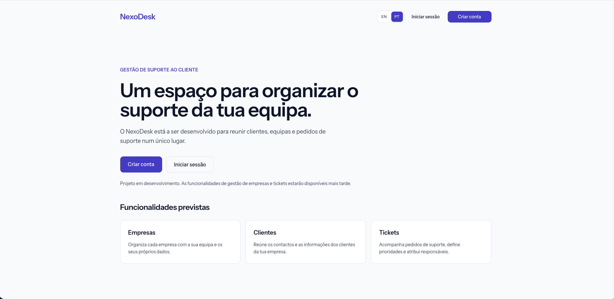

# NexoDesk

A SaaS application for managing customer support tickets across companies.

Built as a portfolio and learning project with Laravel, Vue and TypeScript,
with a focus on maintainable code, authorization and automated testing.

> Work in progress. The project includes authentication, localization,
> company management with membership-based access and role-based permission.
> Invitations, member management and ticket workflows are not implemented yet.

## Preview

## Tech stack

- Laravel 13 and PHP
- Vue 3 and TypeScript
- Inertia.js 3
- Tailwind CSS 4
- Vue I18n
- Pest
- Laravel Wayfinder
- Vite Plus

## Features

- Authentication and account settings.
- English and Portuguese (Portugal) localization.
- Light and dark themes.
- Company creation with automatic owner membership.
- Company listing and details restricted to members.
- Company editing by owners and admins, and deletion by owners.
- Automated tests and continuous integration.

## Roadmap

- Invitations, member management.
- Membership role management and ownership transfer.
- Customer management.
- Ticket creation, assignment and status tracking.
- Dashboard with support activity summaries.
- Public demo deployment.

## Local development

The project is developed locally using Laravel Herd.

After cloning the repository, install the dependencies:

    composer install
    npm ci

Create the environment file and generate the application key:

    cp .env.example .env
    php artisan key:generate

Configure the database connection in `.env`, then run:

    php artisan migrate

Serve the project through Laravel Herd and start the frontend development
server:

    npm run dev

Open the local URL assigned by Herd.

## Development checks

Check frontend formatting and linting:

    npm run check

Run the complete CI checks locally:

    composer ci:check

Apply automatic fixes:

    npm run check:fix

Check TypeScript types:

    npm run types:check

Run backend tests:

    php artisan test

Create a production frontend build:

    npm run build

## Continuous integration

GitHub Actions runs the CI workflow on pushes to `main` and on pull requests.

The workflow prepares PHP 8.4 and Node.js 22, runs `composer setup`,
and then executes `composer ci:check`.

## Localization

The application uses a single language preference stored in the Laravel
session.

- Vue interface translations: `resources/js/locales/en.json` and
  `resources/js/locales/pt-PT.json`.
- Laravel backend translations: `lang/en`, `lang/pt` and language JSON
  files where applicable.
- Locale mapping: `config/localization.php`.

The frontend uses `pt-PT` for Portuguese (Portugal), mapped to `pt`
on the backend to match the Laravel Lang translation files.

`SetLocale` applies the backend locale for each web request.
`HandleInertiaRequests` shares the locale with Vue, and Vue I18n updates
the interface when that value changes.

Custom application text must be added to the appropriate translation files.

## Security approach

Company listing queries are scoped to the authenticated user's memberships.
Laravel policies enforce company access: members can view their companies,
owners and admins can edit them, and only owners can delete them.

Company creation is authorized and validated on the server. The backend
generates the slug and assigns the authenticated user as owner, saving
the company and membership within a single database transaction.

Company deletion removes its memberships while preserving user accounts.
Automated tests cover access restrictions and company data isolation.

Authorization and data isolation for customers and tickets will be
implemented alongside those features.

Environment files, credentials and application secrets must not be committed.
The `.env.example` file should contain placeholders and safe defaults only.

This project is under active development and is not ready for production use.

## Author

Alona Costa
